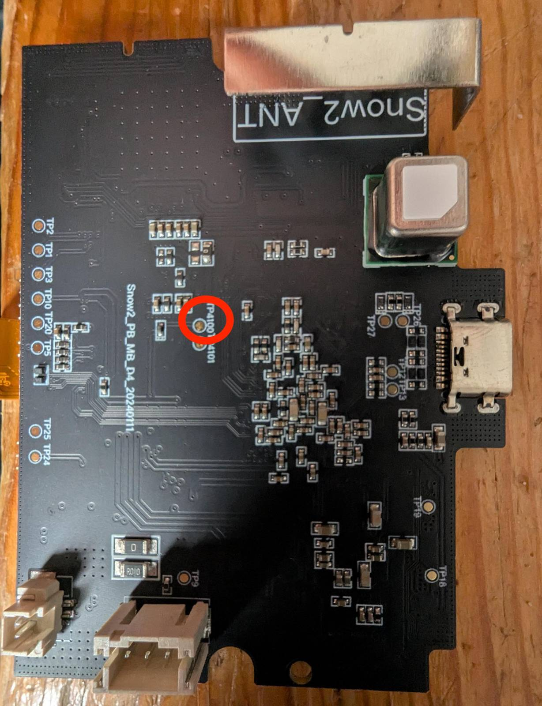
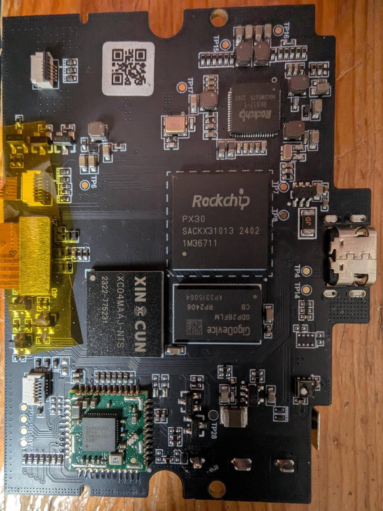

# Recovery

[Install and update](install.md) · [User guide](user-guide.md) · [Architecture](architecture.md)

## Normal restoration

Use **Settings → Reset** to restore vendor software from the stock copy on the monitor.
It erases owner settings, credentials and readings while preserving hardware identity and calibration.
Wi-Fi stays off.
See [Removal](user-guide.md#removal) for the procedure.

If the screen cannot open Reset but USB ADB works, use **Remove the modification** in the computer menu.
The computer uses the same restore worker.
A backup taken after installation includes another copy of the stock archive.
A backup taken before installation needs its matching prepared bundle.

A stock factory reset cannot undo modified system files.
Vendor OTA is not a verified route for reinstalling this firmware.
Without a valid stock copy, computer backup or manufacturer image, complete restoration is not established.
Do not substitute another monitor's storage image.

## Recovery when USB ADB does not start

The procedure below repairs one known fault: an invalid firewall allowlist.
It is not a general firmware installer or a lost-backup replacement.
Use it only if a physical restart does not restore USB ADB.

**CAUTION:** A wrong connection or write can destroy the monitor.
This recovery procedure was tested on hardware with board `Snow2_PB_MB_D4_20240111`.
Other board revisions can differ.

The procedure uses the Rockchip PX30 USB loader mode, called MaskROM.
It loads a program into RAM, compares two flash reads, and changes only one verified 512-byte sector.

### Required tools

- A Mac with command-line developer tools, Git and Homebrew `libusb`.
- `e2fsprogs`, which supplies `debugfs` and `e2fsck`.
- `gptfdisk`, which supplies `sgdisk`.
- At least 8 GB of free storage.
- Tools to open the case and a thin wire.

The host-tool builder is tested on macOS only.
A Linux distribution can supply `rkdeveloptool`, but this recovery procedure has not been tested on Linux.

### Prepare the loader

1. Obtain the pinned Rockchip host-tool source:

   ```sh
   git clone --no-checkout https://github.com/rockchip-linux/rkdeveloptool.git .tools/rkdeveloptool
   ```

2. Select its audited revision:

   ```sh
   git -C .tools/rkdeveloptool checkout --detach 304f073752fd25c854e1bcf05d8e7f925b1f4e14
   ```

3. Build the host tool:

   ```sh
   python3 scripts/build_recovery_tool.py --source .tools/rkdeveloptool --output-dir .tools/rkdeveloptool-build
   ```

4. Set the tool path with `rk=.tools/rkdeveloptool-build/rkdeveloptool`.
5. Create the private folder with `mkdir -p .private/recovery`.
6. Set the pinned loader source:

   ```sh
   rkbin=https://raw.githubusercontent.com/rockchip-linux/rkbin/3968b8eb04e365e64480a6b24f776273c6708e95/bin/rk33
   ```

7. Download the memory initializer:

   ```sh
   curl -fL -o .private/recovery/px30_ddr_333MHz_v2.07.bin "$rkbin/px30_ddr_333MHz_v2.07.bin"
   ```

8. Download the USB program:

   ```sh
   curl -fL -o .private/recovery/px30_usbplug_v1.36.bin "$rkbin/px30_usbplug_v1.36.bin"
   ```

9. Build the loader:

   ```sh
   python3 scripts/build_recovery_loader.py --components .private/recovery --output .private/recovery/px30-loader.bin --remove-read-limit
   ```

10. Check its SHA-256 against `2306f6b49391043eed7e734b69d4da6c715122ea309594b8e7cbbe2bce9688c8`.

The builder rejects unexpected source hashes.
Without `--remove-read-limit`, the USB program returns filler after the first 32 MiB.
This option changes only the two instructions that select that filler.

### Start MaskROM

1. Disconnect the USB cable.
2. Open the case.
3. Disconnect the battery.
4. Disconnect the display and sensors.
5. Remove the main board.
6. Find `TP4100` near the board identification text.
7. Connect `TP4100` to ground with the wire. The metal outside of the USB port can be used for ground.
8. Connect the USB cable to the computer.
9. Remove the wire.
10. Run `"$rk" ld`.
11. Check for `Vid=0x2207,Pid=0x330d` and `Maskrom` in the output.

The electrical function of `TP4100` is unknown.
Do not assume that another board has the same connection.




### Copy the flash memory

**CAUTION:** Use no write commands before you have two identical complete reads.
The copies contain credentials and monitor identity. Keep them private.

1. Load the program into RAM:

   ```sh
   "$rk" db .private/recovery/px30-loader.bin
   ```

2. Read the flash size with `"$rk" rfi`.
3. Set `flash_sectors` to the reported sector count.
4. Read the flash memory:

   ```sh
   "$rk" rl 0 "$flash_sectors" .private/recovery/flash-a.img
   ```

5. Read it again:

   ```sh
   "$rk" rl 0 "$flash_sectors" .private/recovery/flash-b.img
   ```

6. Compare the copies with `cmp .private/recovery/flash-a.img .private/recovery/flash-b.img`.
7. Stop if they differ.

The tested monitor had 7471104 sectors, approximately 3.6 GiB.
Each read took approximately four minutes.
After loading, `ld` still reports `Maskrom`.

### Correct a private copy

1. Display the partition table with `sgdisk -p .private/recovery/flash-a.img`.
2. Set `rootfs_start` to the start sector of `rootfs`.
3. Set `rootfs_size` to its sector count.
4. Extract that partition:

   ```sh
   dd if=.private/recovery/flash-a.img of=.private/recovery/rootfs.img bs=512 skip="$rootfs_start" count="$rootfs_size"
   ```

5. Read the allowlist:

   ```sh
   debugfs -R "cat /etc/cgs2-privacy/allowlist.conf" .private/recovery/rootfs.img
   ```

6. Read the filesystem block size:

   ```sh
   debugfs -R stats .private/recovery/rootfs.img
   ```

7. Locate the allowlist blocks:

   ```sh
   debugfs -R "blocks /etc/cgs2-privacy/allowlist.conf" .private/recovery/rootfs.img
   ```

8. Identify the invalid line and its byte offset within the file.
9. Calculate its absolute flash sector.

   `sector = rootfs_start + file_block × (block_size ÷ 512) + floor(offset_within_block ÷ 512)`

10. Assign that number to `faulty_sector`.
11. Copy the sector:

   ```sh
   dd if=.private/recovery/flash-a.img of=.private/recovery/sector.bin bs=512 skip="$faulty_sector" count=1
   ```

12. Make a working copy with `cp .private/recovery/sector.bin .private/recovery/corrected.bin`.
13. In a hex editor, replace only the invalid line's first character with `#`.
14. Copy the partition with `cp .private/recovery/rootfs.img .private/recovery/rootfs-test.img`.
15. Apply the corrected sector to the test partition:

   ```sh
   dd if=.private/recovery/corrected.bin of=.private/recovery/rootfs-test.img bs=512 seek=$((faulty_sector - rootfs_start)) conv=notrunc
   ```

16. Replay and check the test filesystem with `e2fsck -f -y .private/recovery/rootfs-test.img`.
17. Read its allowlist again with `debugfs`.
18. Stop if the journal replay removed the correction or unexplained filesystem damage remains.

Valid entries use `tcp:IPv4:port` or `udp:IPv4:port`.
Lines beginning with `#` are comments.
Changing one byte preserves the file size and block allocation.
This procedure does not cover an allowlist repair that needs more sectors or metadata changes.

### Write the verified sector

1. Read the original sector again:

   ```sh
   "$rk" rl "$faulty_sector" 1 .private/recovery/before.bin
   ```

2. Compare it with `cmp .private/recovery/before.bin .private/recovery/sector.bin`.
3. Stop if it differs.
4. Write the correction:

   ```sh
   "$rk" wl "$faulty_sector" .private/recovery/corrected.bin
   ```

5. Read it back:

   ```sh
   "$rk" rl "$faulty_sector" 1 .private/recovery/after.bin
   ```

6. Compare the result with `cmp .private/recovery/after.bin .private/recovery/corrected.bin`.
7. Stop if it differs.
8. Disconnect USB.
9. Reconnect the display, sensors and battery.
10. Assemble the monitor.
11. Start the monitor.
12. Reconnect USB.
13. Select **Examine the installation** in the menu.

The flash copies cover the eMMC user area.
They do not include the separate eMMC boot partitions.
